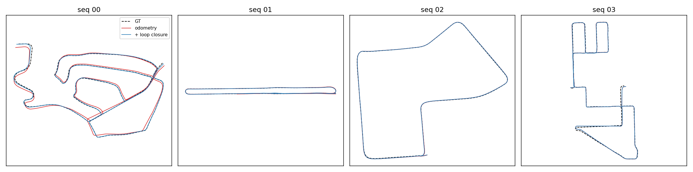
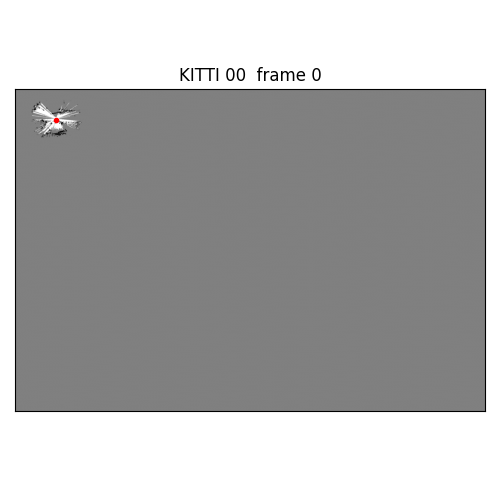
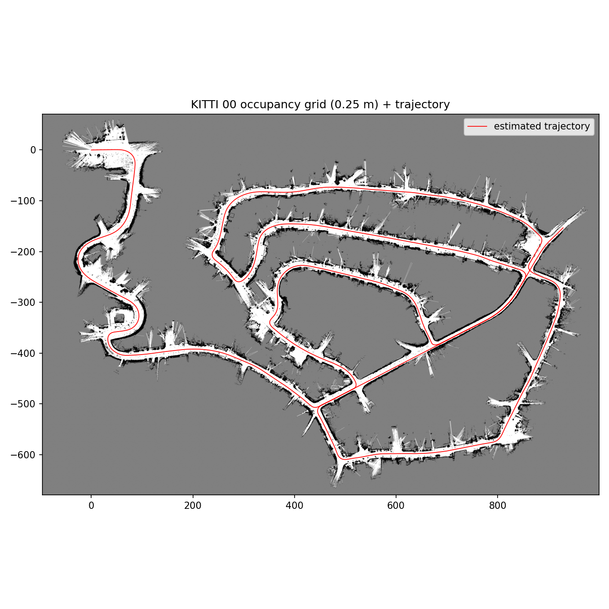

# KITTI LiDAR SLAM: scan-to-map ICP odometry + Scan Context loop closure + pose-graph optimisation

A complete, from-scratch LiDAR SLAM system in ~700 lines of Python, evaluated on four
KITTI odometry sequences with the official KITTI drift metric, ATE/RPE, a loop-closure
precision check against ground truth and an ablation of every front-end design choice.

<p align="center">

</p>

<p align="center">
&nbsp;

</p>

## System overview

```
Velodyne scan ─► voxel filter ─► scan-to-local-map ICP ─► odometry pose ──┐
                                 (point-to-plane, Tukey,                   │
                                  constant-velocity prior,                 ▼
                                  adaptive threshold)          Scan Context descriptor
                                                                ring-key kNN search
                                                                ICP verification (fitness/RMSE)
                                                                        │ loop factor
                                                                        ▼
                        occupancy grid / point-cloud map ◄── GTSAM SE(3) pose graph (2-stage LM)
```

| module | file | what it does |
|---|---|---|
| Front-end odometry | `lidar_slam/odometry.py` | KISS-ICP-style scan-to-local-map registration: sliding-window voxel map with normals, point-to-plane ICP with a Tukey robust kernel, constant-velocity motion prior and an adaptive correspondence threshold driven by the prediction error |
| Place recognition | `lidar_slam/loop_closure.py` | Scan Context (20 rings x 60 sectors) written from scratch; ring-key KD-tree retrieval, yaw-shift-invariant cosine distance, geometric verification by ICP against a keyframe submap with fitness and inlier-RMSE gates |
| Back-end | `lidar_slam/pose_graph.py` | GTSAM SE(3) pose graph; two-stage optimisation (plain Gaussian loop factors first so large-but-correct loop residuals can pull the graph, then Huber-robustified factors to suppress inconsistent loops) |
| Mapping | `lidar_slam/mapping.py` | 2-D log-odds occupancy grid with vectorised ray casting (free-space + hits) and a voxelised 3-D point-cloud map, both rebuilt from the optimised trajectory |
| Evaluation | `lidar_slam/evaluation.py` | ATE (after Umeyama SE(3) alignment), RPE, and the official KITTI relative translational/rotational drift over 100-800 m segments |

## Results

**Per-sequence results** (ATE after SE(3) alignment; end error = unaligned final-pose error; drift = official KITTI metric averaged over 100-800 m segments)

| seq | frames | path [m] | loops | odom drift t[%] / r[deg/100m] | ATE odom [m] | ATE +PGO [m] | end err odom [m] | end err +PGO [m] |
|---|---|---|---|---|---|---|---|---|
| 00 | 933 | 5065 | 21 | 1.51 / 0.92 | 26.24 | 9.14 | 73.1 | 44.6 |
| 01 | 221 | 1232 | 10 | 0.46 / 0.30 | 0.69 | 0.51 | 5.7 | 3.5 |
| 02 | 221 | 694 | 2 | 0.74 / 0.86 | 1.33 | 0.66 | 5.6 | 0.1 |
| 03 | 815 | 3221 | 3 | 1.67 / 0.78 | 7.64 | 7.32 | 26.5 | 29.8 |

**Front-end ablation** (sequence 00, odometry only, everything else fixed)

| variant (seq 00, odometry only) | drift t [%] | drift r [deg/100m] | ATE [m] | end err [m] |
|---|---|---|---|---|
| full system (scan-to-map, point-to-plane, Tukey, adaptive thr.) | 1.50 | 0.91 | 25.51 | 71.2 |
| point-to-point instead of point-to-plane (this switch also drops the Tukey kernel, see `odometry.py`) | 4.70 | 2.11 | 93.59 | 299.5 |
| scan-to-scan instead of scan-to-local-map | 2.06 | 1.23 | 42.05 | 117.3 |
| no robust kernel | 2.20 | 1.33 | 43.73 | 115.6 |
| fixed 3 m threshold instead of adaptive (the adaptive rule sits at its 2.0 m cap most of the time, so this mostly compares 3 m vs 2 m) | 1.92 | 1.15 | 30.53 | 84.2 |

Throughput: 1.8-2.2 scans/s for the full front end (odometry + Scan Context search, 2 CPU cores, Open3D ICP,
Python everywhere else) as logged in `results/log_*.txt`; the scan-to-scan ablation runs at 3.3 scans/s. The main cost
is rebuilding the local map with normals every frame; an incremental voxel-hash map is the obvious next step.


Notes on the data: this repository uses a course-provided subset of four KITTI odometry
sequences, numbered 00-03 by the course, with every 5th frame kept (~5 m of motion between
scans instead of ~1 m at the native 10 Hz). Frame counts, path lengths and trajectory shapes
indicate that course 00/01/02/03 correspond to official KITTI 02/06/07/08 (933, 221, 221 and
815 frames from 4661, 1101, 1101 and 4071); course 01 is therefore the long straight road of
official 06, not the highway of official 01. Metrics are not directly comparable to numbers
reported on full-rate KITTI, but the subsampling makes registration considerably harder, which
is why the design choices below matter.

Loop-closure precision: `tools_verify_loops.py` reads `loop_list` from `results/*/metrics.json`
and computes the ground-truth distance between the two frames of every accepted loop
(`loop_verification.csv/json` per sequence). With the fitness >= 0.8 and inlier-RMSE <= 0.3 m
gates, all 36 accepted loops on the four sequences are true positives (GT distance < 10 m).
The 8 candidates rejected by the gates are not labelled: several of them point at the same
target frames as accepted loops and are probably true loops that missed the threshold, so the
gates are conservative rather than perfectly selective.

## What I learned / design decisions that mattered

1. **The correspondence threshold has to cover the per-frame motion.** With ~5 m between
   scans, an initial 1 m threshold made ICP lock onto an aliased solution on the highway
   (guardrails repeat every few metres): the estimated speed was ~4x too low for the first
   30 frames and the trajectory was 160 m short. Starting at 3 m and letting the adaptive
   rule shrink it fixed sequence 01 from 190 m to 3 m end-point error over the first 45
   frames.
2. **Loop verification must be strict.** Scan Context alone produced plausible false
   matches on repetitive suburban streets (seq 03); gating on ICP fitness and RMSE removed
   all false positives among the accepted loops (verified against ground truth, see above). A false loop is far worse than a missed one: the pose graph will
   happily fold the map to satisfy it.
3. **Robust kernels fight you when the residual is real.** With Huber on loop factors from
   the start, a correct 130 m loop residual (accumulated drift) was down-weighted to almost
   nothing. Optimising once without the kernel and then once with it keeps the outlier
   protection without losing the correction. In the logged runs the second stage only changed
   sequence 00 (stage-1 error 431 -> Huber-weighted 88 -> 55), where it down-weights accepted
   loops whose relative pose disagrees with the odometry; on 01-03 both stages coincide.
4. **Pose-graph optimisation cannot fix odometry that was wrong in one place.** It spreads
   the correction over all edges; if the drift happened in 30 frames the result is still
   off everywhere else. Good odometry is not optional.

Each configuration was run once; the full-system row of the ablation and the main-table odometry row differ by
0.7 m ATE / 0.007 % drift on identical settings, which is the run-to-run noise floor (Open3D multithreading) to read
the ablation against.

## Run it

```bash
pip install -r requirements.txt
python tools_prepare_kitti.py --root /path/to/KITTI --seq 00 01 02 03   # once, builds lite/ frames
python run_slam.py --data /path/to/KITTI --seq 00 --gif                  # full pipeline + figures
python run_slam.py --data /path/to/KITTI --seq 00 --no_loop --point_to_point   # ablation switches
python tools_verify_loops.py --data /path/to/KITTI --seq 00 --metrics results/00/metrics.json   # loop GT check
python make_report.py                                                   # tables + summary figure
pytest -q                                                               # unit tests
```

Outputs per sequence: `trajectory.png`, `map_with_trajectory.png`, `occupancy_map.png`,
`mapping.gif`, `map.pcd`, `metrics.json`, `poses_*.npy`.

## References

Vizzo et al., *KISS-ICP* (RA-L 2023) · Kim & Kim, *Scan Context* (IROS 2018) ·
Dellaert et al., *GTSAM* · Geiger et al., *KITTI Vision Benchmark* (CVPR 2012)
